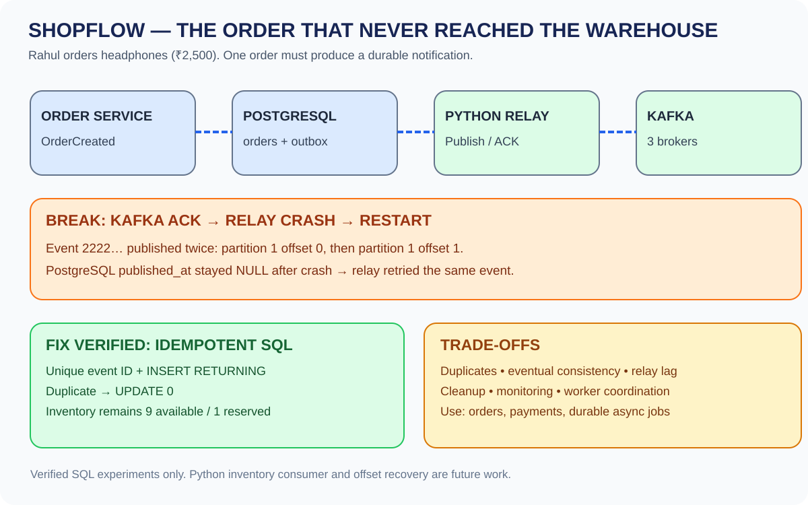

# Microservices Trade-offs — Mission Battle Ready

**Created & maintained by Guru Prasad Pattnayak**

An open-source, hands-on distributed-systems course: **build → break → observe → recover → defend the trade-off**.

## 🌐 Play Mission Battle Ready

**Live site:** https://mission-battle-ready-systems-quest.vercel.app/

| Mission | Interactive lesson | Source / lab | Evidence level |
|---|---|---|---|
| 001 — ShopFlow Transactional Outbox | [Save Rahul's Order](docs/index.html#outbox) | [Real PG + Kafka + Python lab](labs/001-transactional-outbox/README.md) | Reproducible local observations |
| 002 — Saga / Durable Workflow SDK | [Saga Incident Control Room](docs/saga.html) | [SDK roadmap](#mission-002--saga-sdk-roadmap) | **Browser simulation only**; SDK not implemented yet |

## Mission 001 — Transactional Outbox

Rahul's order was saved but its event might not reach the warehouse. Reproduce:

- PostgreSQL transaction committing the order and outbox event together
- Python relay publishing to a local three-broker Kafka cluster
- Crash after Kafka ACK but before the PostgreSQL published marker
- Duplicate delivery and the need for an idempotent consumer
- SQL inventory reservation and rollback edge cases

[Run the lab](labs/001-transactional-outbox/RUNBOOK.md)

## Mission 002 — Saga SDK roadmap

**Goal:** Build a lightweight **Python + PostgreSQL** durable Saga SDK with no Temporal SaaS dependency. Application developers provide business steps; the SDK handles durable orchestration plumbing.

**Already available:** [Browser-based interactive simulator](docs/saga.html) with:

- Payment timeout and unknown remote outcome
- Worker crash after an inventory reservation
- Failed inventory-release compensation
- Guided Beginner, Senior, and Staff modes
- Simulated metrics, logs and traces; explicit failure injection
- Diagnosis selection with evaluation **only after submission**
- Creator feedback through [GitHub Issues](https://github.com/bapuoldtown/microservices-tradeoffs/issues/new)

**Not implemented yet:** backend runtime, Postgres journal, actual SDK, actual OpenTelemetry/Prometheus/Grafana, Docker Compose, Kubernetes incident automation. The website's example telemetry is fictional training data, **not real production measurements**.

### Planned SDK guarantees and tasks

1. Persist Saga/step state and an operation ID before external effects.
2. Retry and reconcile uncertain outcomes using stable idempotency keys.
3. Implement workers, leases, fencing tokens and a recovery scanner.
4. Execute reverse-order compensating business actions; persist compensation failures.
5. Capture OpenTelemetry spans, Prometheus counters/histograms and structured logs.
6. Test deliberate process kills, network delays, DB connection exhaustion, concurrent workers, rolling deployments and stuck-workflow alerts.
7. Document guarantees and limitations honestly; do **not** promise exactly-once external actions.

**Local development target:** Windows + WSL2, Docker PostgreSQL, existing Kafka cluster and disposable kind namespaces. No paid SaaS required.

## Contributing

Please [suggest an improvement or a new incident](https://github.com/bapuoldtown/microservices-tradeoffs/issues/new). Feedback requires a GitHub account. Never paste private credentials into a public issue.

> Educational source and examples. Mission 001 SQL exercises and Mission 002 simulator are not production-ready transaction processing infrastructure.
