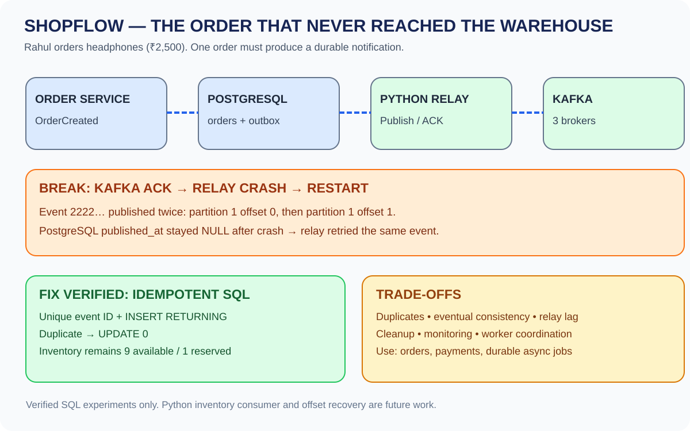

# Lab 001 — ShopFlow: The Order That Never Reached the Warehouse

> **Problem:** Rahul orders headphones worth ₹2,500. The website says **Order Confirmed**, but the warehouse never hears about it.

The Order Service commits the order to PostgreSQL and then tries to publish `OrderCreated` to Kafka. A crash between the two operations leaves a confirmed order without an event. This is the **dual-write problem**.

## The fix: transactional outbox

Store **both the order and an outbox event in the same PostgreSQL transaction**. A relay later publishes pending events to Kafka. This preserves the intent to publish when the order commits; it does **not** guarantee only one Kafka record per business event.

[Open the editable Excalidraw source](architecture/shopflow-outbox.excalidraw).

## What we actually verified

| Experiment | Observation |
|---|---|
| Atomic order + outbox insert | Both committed together |
| Duplicate outbox event PK | Whole transaction aborted |
| Separate commits | Orphaned order was possible |
| Crash after Kafka ACK | Event `2222…` acknowledged at partition **1**, offset **0**; `published_at` remained NULL |
| Relay restarted | Same event published at partition **1**, offset **1** |
| Kafka consumer read both records | Identical `event_id` and payload at offsets 0 and 1 |
| Duplicate inventory SQL | `UPDATE 0`; inventory remained **9 available / 1 reserved** |
| Insufficient stock | Marker inserted even though reservation returned `UPDATE 0`; `ROLLBACK` removed marker and restored stock |

**Not yet implemented:** a real Python Kafka inventory consumer, consumer offset crash/recovery, safe multi-relay claiming, full operational hardening.

## Lab setup

- Windows PowerShell + `uv` + Python
- Docker PostgreSQL container `pg` (Postgres 16); DB `mbr_outbox_lab`
- Three Docker Kafka brokers `kafka-1`, `kafka-2`, `kafka-3`
- Kafka host bootstrap `localhost:29092`; CLI inside kafka-1 `localhost:19092`
- Topic `mbr.order.events`: 3 partitions, replication factor 3, `min.insync.replicas=2`
- Python: `uv add "psycopg[binary]" confluent-kafka`

Start with [the full build/break/observe runbook](RUNBOOK.md), then see [schema and seed SQL](sql/01_schema.sql).

## When should you use transactional outbox?

**Use it when** a committed database change must reliably trigger asynchronous downstream work: e-commerce orders → inventory; payments → ledger notifications; SaaS provisioning requests → workers; durable AI job submissions → inference queues.

**Avoid adding it by default** when no durable database state and external event must be coordinated, or when simpler synchronous logic meets the business requirements. Outbox adds an extra moving part.

## Trade-offs and Staff-level considerations

1. **At-least-once publishing:** ACK followed by relay crash can duplicate an event. Consumer-side idempotency is required.
2. **Eventual consistency:** downstream state lags behind the order commit.
3. **Operational cost:** monitor relay backlog/age, delivery errors, retries, retention and cleanup.
4. **Concurrent relays:** this educational relay has no safe claiming; production needs coordinated claims/leases or an alternative such as CDC.
5. **Ordering:** design per-aggregate ordering, especially across concurrent updates.
6. **Poisoned idempotency markers:** do not commit a processed-event marker when the business operation failed; rollback or record a deliberate terminal outcome.
7. **Exactly-once nuance:** producer idempotence does not make PostgreSQL and Kafka a single atomic transaction.

**Core lesson:** A reliable outbox preserves publication intent; an idempotent consumer protects business effects from redelivery.
