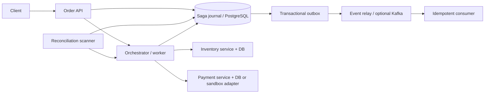
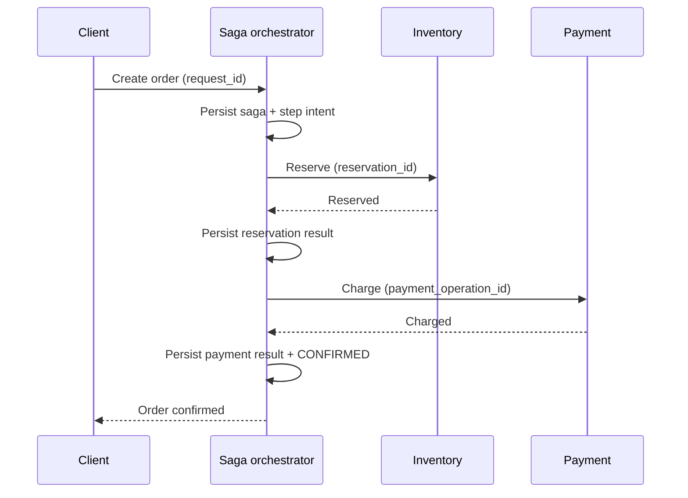

# Mission 002 — Saga Under Fire: Build → Break → Observe → Recover

> **Status:** Design and guided lab specification. The browser simulator exists at [docs/saga.html](../../docs/saga.html); the real backend and experiments below are **not yet implemented**. Never confuse simulated metrics with measured results.

## Audience and objective
A small, reproducible Python + PostgreSQL project for beginners through Staff engineers. Explain **why** each reliability mechanism exists before adding it. Use local Docker/WSL2; Kafka and kind are optional extensions. No Temporal dependency.

## Problem statement
An order for ₹1,000 needs an inventory reservation and a payment charge, owned by separate services/databases. There is no atomic transaction across all participants. A payment can succeed while its HTTP response is lost; the orchestrator can crash; a compensation can fail; two recovery workers can race; an expired worker can resume after a successor claims the workflow. Preserve business invariants despite these failures.

**Business invariants**
1. Never knowingly charge twice for one payment operation; reuse a stable provider idempotency key and verify provider semantics.
2. Do not mark an order CONFIRMED without both a verified reservation and verified payment.
3. Do not release inventory while a confirmed order still owns it.
4. Do not declare CANCELLED until necessary compensations are verified, or mark NEEDS_REPAIR explicitly.
5. Each Saga state transition is durable, legal, and concurrency-controlled.

## Architecture



For learning, start with separate PostgreSQL schemas in **one local Postgres container** to make ownership boundaries visible, then optionally move to separate containers. Schemas in one DB are a pedagogical convenience, **not real independent failure domains**. Avoid cross-schema transactions in the application.

## Happy path


## Failure missions (run each with and without the fix)

| Mission | Inject | Observe | Fix | Trade-off |
|---|---|---|---|---|
| 001 Unknown outcome | Charge succeeds; response dropped | Timeout does not imply failure | Stable idempotency key; query provider before deciding | Provider semantics, latency, retention limits |
| 002 Compensation | Reservation succeeds; payment definitively declines | Stock held for failed order | Durable reverse action RELEASE reservation | Compensation is a new business transaction, not rollback |
| 003 Failed compensation | Release times out or fails | Saga stuck COMPENSATING | Persist attempt + retry/backoff + NEEDS_REPAIR | Delayed resolution, manual intervention |
| 004 Crash | Kill orchestrator after side effect | DB journal lags reality | Write intent first; recover and query by operation ID | More writes, recovery complexity |
| 005 Double recovery | Two scanners claim same saga | Both try to act | Atomic claim / compare-and-swap and lease | Contention and lease tuning |
| 006 Stale worker | Pause A, expire lease, B claims, resume A | A tries old state write | Monotonic fencing token checked by journal/owned resource | External APIs may not honor fencing |
| 007 Concurrent cancel | Customer cancels while scanner confirms | Conflicting terminal states | Explicit state machine, version CAS, serialized transition decisions | More coordination; external effects still need reconciliation |
| 008 Lost event | Commit DB then crash before publish | Missing downstream notification | Transactional outbox + retrying relay | At-least-once publication, storage overhead |
| 009 Duplicate/reordered event | Redeliver older event | Repeated or regressive action | Inbox dedupe, version/sequence checks | Dedupe storage and ordering constraints |
| 010 Poison workflow | Permanent refund failure | Endless retry or hidden loss | Bounded retries, alert, manual repair workflow | Human operations required |

## Concurrency: lease + fencing, precisely
A lease controls *who should work*. It does not stop a paused process from waking up. A fencing token is a monotonically increasing generation assigned at successful ownership claim. Guard each **local journal write** using `WHERE saga_id = :id AND fence = :token AND version = :expected_version`; if zero rows update, worker is stale and must stop. For a protected downstream resource, it must independently reject older generations. **Never claim that local fencing prevents a stale worker from calling an uncooperative external payment provider.** External effects also need stable operation IDs, provider idempotency, status lookup and reconciliation.

Example claim idea (implement transactionally, not as separate read/write):
```sql
UPDATE saga
SET owner_id = :worker,
    lease_until = clock_timestamp() + interval '30 seconds',
    fence = fence + 1,
    version = version + 1
WHERE id = :id
  AND (lease_until IS NULL OR lease_until < clock_timestamp())
  AND status IN ('RUNNING','COMPENSATING','RECONCILING')
RETURNING fence, version;
```
Only one claimant can win a given row update; add renewal, lock timeout, ownership checks and crash tests. Time must come from the database consistently. Fencing is scoped to the resource validating it.

## Reconciliation algorithm (conceptual)
1. Find nonterminal sagas whose next check is due; atomically claim one.
2. Read durable intent and operation IDs. Never infer remote failure from timeout alone.
3. Query participant's authoritative status by stable operation ID.
4. If verified success, advance using legal version-checked transition; if verified failure, choose the appropriate compensation; if still unknown, schedule another check.
5. Persist compensation intent before issuing it. Reconcile compensation's unknown outcome too.
6. Persist next attempt, error category, timestamps and correlation IDs. Alert on age and repeated failures.
7. If CAS/fence check fails, abandon local ownership. Do not overwrite the newer state.

**Cancellation race:** A cancel request records cancellation intent with a version check; it does not blindly flip the Saga to CANCELLED. Reconciliation sees that intent and chooses a valid transition based on verified external effects. Terminal state means the business invariants hold.

## Minimal implementation layout (planned)
```text
labs/002-saga-under-fire/
  README.md
  docker-compose.yml
  migrations/
  services/order_api/
  services/inventory/
  services/payment_sandbox/
  workers/orchestrator.py
  workers/reconciler.py
  tests/test_failure_missions.py
  scripts/inject_failure.py
  observability/prometheus.yml
```

### Interactive teaching contract
Every mission presents: **story → diagram → prediction (no answer preselected) → failure injection → inspect SQL/logs → choose fix → rerun → compare evidence → trade-off disclaimer**. Reveal checkpoint answers only after the learner submits. Provide beginner hints and Staff-level concurrency questions. Browser exercises are explicitly labeled *simulation* until real backend evidence is connected.

### Evidence to capture per experiment
Record command, expected vs observed DB rows, event/operation IDs, worker ID, fence, version, timestamps, relevant logs, duplicate count, retries, duration, and reproducible reset command. Measure only when actual code runs; never invent graphs or metrics.

## Important disclaimers
- Saga provides **eventual business consistency**, not global ACID isolation.
- Compensation is not necessarily the exact inverse of the original action (refund ≠ undo charge).
- Idempotency is scoped to an operation and depends on retention and provider guarantees; it is not global exactly-once execution.
- Leases do not revoke paused workers. Fencing works only where tokens are checked.
- Reconciliation may remain unresolved when remote truth cannot be obtained; require operator escalation.
- A DB outbox prevents the DB/event-intent dual-write gap, but relays may publish duplicates.
- Concurrent user commands need domain-specific precedence rules and legal state transitions.
- All implementation paths above are **planned**, not claimed to exist.

## Recommended implementation order
First implement 001–004 with real Postgres and a deterministic payment sandbox; then 005–007 with two competing workers and process pauses; then 008–010 with outbox, consumer, observability and manual-repair exercises. Keep the lab small; do not introduce Kafka or Kubernetes until the core Saga correctness tests pass.
